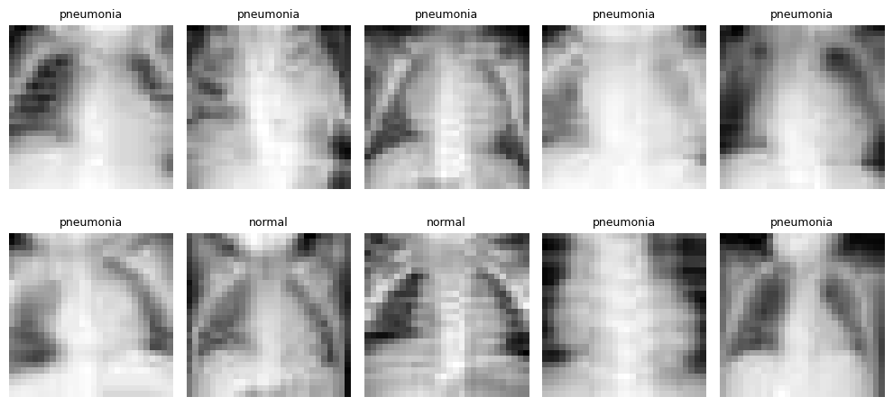
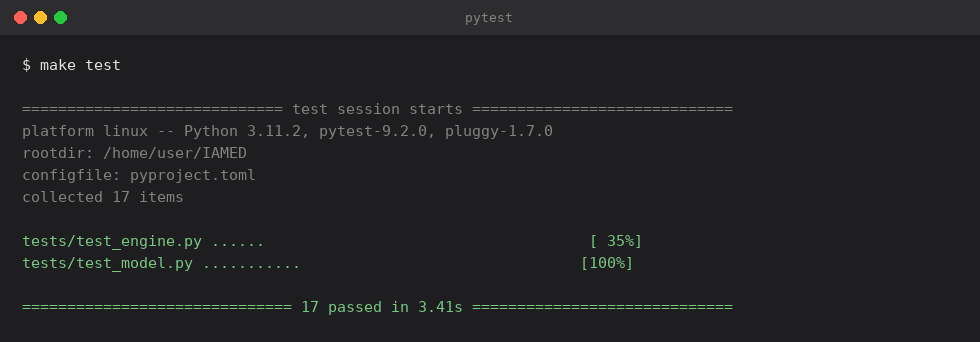
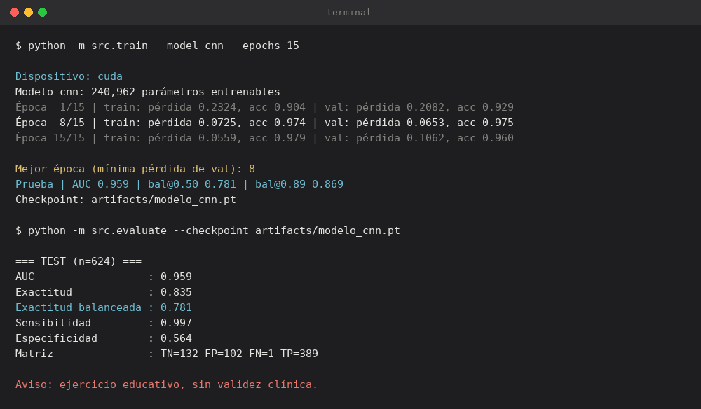
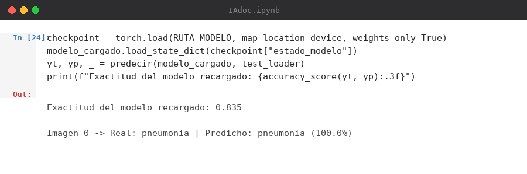
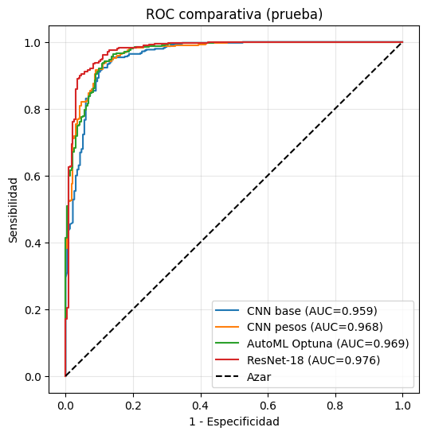
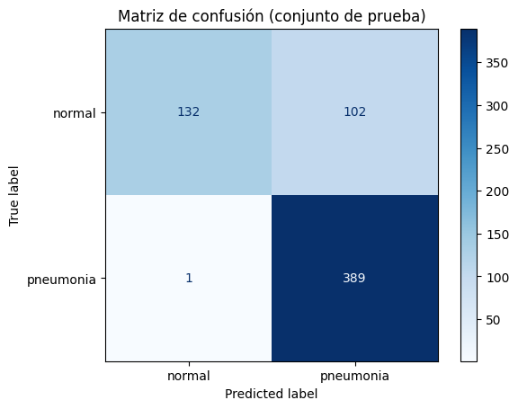
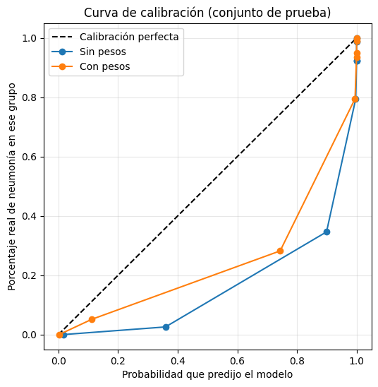
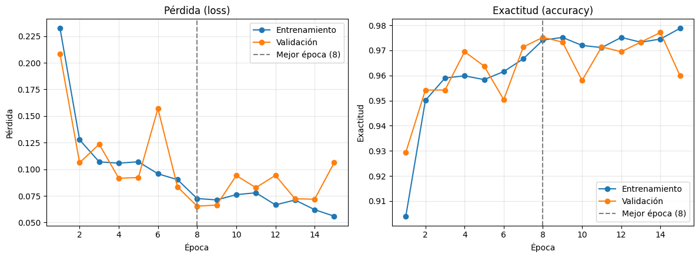

<div align="center">

# Clasificador de radiografías pediátricas con PyTorch

### MedMNIST · CNN + AutoML (Optuna) + ResNet-18 · evaluación estadística honesta

[](https://colab.research.google.com/github/abdiellzz/IAMED/blob/main/IAdoc.ipynb)
[](requirements.txt)
[](requirements.txt)
[](LICENSE)
[](DATA_LICENSE.md)
[](MODEL_CARD.md)


</div>

> [!CAUTION]
> ### No tiene validez clínica
> Este repositorio es un **ejercicio educativo y retrospectivo**. Los modelos **no son
> dispositivos médicos**, no están validados, y **no deben usarse para diagnosticar,
> descartar ni priorizar** a ningún paciente. Las imágenes se reducen a **28 × 28 píxeles**
> y proceden de un único conjunto de datos público, sin validación externa ni prospectiva.
> Ficha completa: [`MODEL_CARD.md`](MODEL_CARD.md).

---

## Qué es esto, en 60 segundos

<table>
<tr>
<td width="50%" valign="top">

**El problema**

Clasificar radiografías de tórax **pediátricas** en `normal` vs `neumonía`, usando
**PneumoniaMNIST** (MedMNIST v2): imágenes de 28 × 28 píxeles en escala de grises.

**Los datos**

| Split | Imágenes |
|---|---:|
| train | 4 708 |
| val | 524 |
| **test** | **624** |

Desbalance en test: **234 normal / 390 neumonía** → un modelo que siempre diga "neumonía"
acierta **0.625**. Por eso la métrica principal es la **exactitud balanceada**, no la exactitud.

</td>
<td width="50%" valign="top">

**Los cuatro modelos comparados**

| # | Modelo | Idea |
|---|---|---|
| 1 | **CNN base** | Desde cero, 240 962 parámetros |
| 2 | **CNN + pesos** | Pérdida ponderada por desbalance |
| 3 | **AutoML** | Optuna/TPE, 25 pruebas, pruning |
| 4 | **ResNet-18** | ImageNet + ajuste fino, 11,2 M parámetros |

**Lo que hace distinto este repositorio**

No es "entrené una CNN y salió 97%". Incluye **intervalos de confianza por bootstrap**,
**test exacto de McNemar** con Bonferroni, **variabilidad entre semillas** y una discusión
explícita de **cuándo el modelo falla y por qué**.

</td>
</tr>
</table>

---

## Cómo se ve

<div align="center">

**Las imágenes con las que trabaja el modelo** — radiografías reales a 28 × 28 píxeles:



</div>

> A esta resolución se distingue poco más que la silueta del tórax. Es la primera limitación
> del proyecto y conviene tenerla presente antes de mirar las métricas.

---

## Capturas reales

Salidas **reales** del código de este repositorio. Nada de mockups.

**Los tests pasan** (17 tests, ~3 s, sin GPU ni datos):

<div align="center">

</div>

**El CLI entrena y evalúa** (mismos números que el cuaderno):

<div align="center">

</div>

**La celda del cuaderno que guarda y recarga el modelo** (salida guardada en `IAdoc.ipynb`):

<div align="center">

</div>

---

## Código reutilizable (`src/`)

El cuaderno es la narrativa; `src/` es la versión que puedes importar y ejecutar.

```text
src/
├── data.py # loaders con las transformaciones exactas del cuaderno
├── model.py # CNNSencilla + ResNet-18 adaptada + pesos por clase
├── engine.py # entrenamiento, predicción, umbral, métricas
├── train.py # CLI de entrenamiento
└── evaluate.py # CLI de evaluación e inferencia de una imagen
tests/ # 17 tests (formas, parámetros, métricas, umbral)
```

```bash
make test # 17 tests en ~3 s
make train MODEL=cnn EPOCHS=15 # entrena y guarda el checkpoint
make evaluate # métricas en el split de prueba

# o sin make:
python -m src.train --model cnn --epochs 1 # smoke test rápido
python -m src.evaluate --checkpoint artifacts/modelo_cnn.pt --imagen rx.png
```

**Clasificar una imagen suelta** (con el aviso de siempre):

```console
$ python -m src.evaluate --checkpoint artifacts/modelo_cnn.pt --imagen rx.png

Checkpoint: artifacts/modelo_cnn.pt | arquitectura: cnn
Imagen: rx.png
  Predicción: normal (51.0 %)
  P(neumonía): 0.4895

  Aviso: ejercicio educativo, sin validez clínica.
```

> [!NOTE]
> `src/` **extrae** la lógica ya validada del cuaderno: no cambia arquitecturas,
> hiperparámetros ni transformaciones. `tests/test_engine.py` lo comprueba reproduciendo
> la matriz de confusión del README (TN=132, FP=102, FN=1, TP=389) a partir de esos conteos.

---

## Resultados

Conjunto de **prueba** (n = 624), umbral fijo **u = 0.50**, IC 95 % por bootstrap
(2 000 remuestras). Todos los valores están copiados de las salidas reales del cuaderno.

| Modelo | AUC | Exact. bal. (u = 0.50) | IC 95 % bootstrap | |
|---|---:|---:|---|:--:|
| CNN base | 0.959 | 0.781 | [0.750 – 0.813] | |
| CNN + pesos | 0.968 | 0.848 | [0.818 – 0.878] | |
| AutoML (Optuna) | 0.969 | **0.892** | [0.866 – 0.918] | mejor exact. bal. |
| ResNet-18 | **0.976** | 0.869 | [0.841 – 0.897] | mejor AUC |

> Reconocimiento de honestidad: el cuaderno imprime **0.868** para ResNet-18 en su celda
> propia (35) y **0.869** en la comparativa final (37). Esta tabla usa la de la comparativa,
> que es la que alimenta el bootstrap y McNemar. No se ha retocado ninguna cifra.

### Curvas ROC comparativas

<div align="center">

</div>

Las cuatro curvas son **casi indistinguibles**. Eso no es un fallo del gráfico: es el resultado.
AUC 0.959–0.976 con n = 624 e intervalos que se solapan significa que **no se puede declarar
un ganador**.

### ¿La diferencia es real? Test de McNemar

| Comparación | Acierta solo A | Acierta solo B | p-valor | Veredicto |
|---|---:|---:|---:|:--|
| AutoML vs ResNet-18 | 22 | 14 | **0.2430** | no significativo |
| CNN + pesos vs ResNet-18 | 13 | 23 | **0.1325** | no significativo |
| AutoML vs CNN + pesos | 24 | 6 | **0.0014** | significativo (también con Bonferroni α = 0.0167) |

### Matriz de confusión de la CNN base

<div align="center">

</div>

Los **102 falsos positivos frente a 1 solo falso negativo** explican una sensibilidad del
0.997 con especificidad del 0.564. La CNN no "detecta neumonía": tiende a decir que sí a casi
todo. La exactitud de 0.835 es solo 21 puntos mejor que la del clasificador trivial (0.625).

<table>
<tr><td width="50%">

| Métrica | CNN base | CNN + pesos |
|---|---:|---:|
| Exactitud | 0.835 | 0.883 |
| Sensibilidad | 0.997 | 0.987 |
| Especificidad | 0.564 | 0.709 |
| F1 | 0.883 | — |
| Brier (↓ mejor) | 0.1326 | **0.0964** |

</td><td width="50%">

**Calibración** (¿las probabilidades significan algo?)

La curva está lejos de la diagonal perfecta: el modelo **infravalora** las probabilidades
bajas. Mejora al añadir pesos de clase (Brier 0.1326 → 0.0964), pero sigue sin estar
calibrado. Una probabilidad de 0.38 corresponde a un 4 % real.

</td></tr>
</table>

<div align="center">

</div>

### Entrenamiento y sobreajuste

<div align="center">

</div>

La pérdida de validación **oscila** mientras la de entrenamiento baja de forma monótona: la
brecha crece tras la época 8. Es la señal temprana de que el modelo empieza a memorizar, y la
razón de guardar el checkpoint por pérdida de validación y no por época final.

### Variabilidad entre semillas (lo que casi nadie reporta)

| CNN, 3 semillas (42, 7, 123) | AUC | Exact. bal. (u = 0.50) |
|---|---:|---:|
| Sin pesos | 0.966 ± 0.005 | 0.781 ± 0.016 |
| Con pesos | 0.967 ± 0.005 | 0.829 ± 0.018 |

**± 0.02 entre semillas** es del mismo orden que las diferencias que se interpretan entre
modelos. Cualquier conclusión más fina que eso no es defendible con estos datos.

---

## Hallazgos clave

1. **ResNet-18 tiene el mejor AUC (0.976)** — mejor *ranking* de pacientes —, **pero no es
   significativamente mejor** que AutoML en exactitud balanceada (0.869 vs 0.892; IC 95 %
   solapados; McNemar p = 0.2430).
2. **AutoML supera a la CNN simple en este split** (0.892 vs 0.781; p = 0.0014, significativo
   incluso tras Bonferroni), **pero con n = 624 la potencia es limitada** y ± 0.02 entre semillas.
3. **Los umbrales elegidos en validación empeoraron en prueba**: AutoML con u = 0.12 cae de
   0.892 a **0.852**; ResNet-18 con u = 0.33 cae de 0.869 a **0.848** (la CNN con pesos, en
   cambio, *mejora* de 0.848 a 0.876). Evidencia de ***distribution shift*** entre splits:
   un umbral no es una propiedad del modelo, sino del reparto de datos.
4. **Las 25 pruebas de Optuna pueden haber sobreajustado la validación**: 0.978 en validación
   frente a **0.852** en prueba con el mismo umbral, porque el valor de validación es el
   máximo de 25 intentos sobre 524 imágenes.
5. **No hay validez clínica.** Retrospectivo, 28 × 28, un solo conjunto de datos, ningún
   centro externo.

> **El hallazgo 3 no es unánime, y eso es parte del resultado.** AutoML y ResNet empeoran al
> transferir el umbral; la CNN con pesos mejora. Por eso se describe como *inestabilidad de
> umbrales* y no como una ley general. El AUC, que no depende de umbrales, se mantiene ≈ 0.97.

---

## Cómo se ejecuta

### Opción A — Google Colab (recomendada, 1 clic)

<div align="center">

[](https://colab.research.google.com/github/abdiellzz/IAMED/blob/main/IAdoc.ipynb)

</div>

1. Pulsa el badge.
2. Menú **Entorno de ejecución → Ejecutar todas**.
3. Acepta el aviso de que el cuaderno no es de Google.
4. Espera. Con GPU T4: **20–40 min**. En CPU funciona igual, bastante más lento.

El cuaderno instala lo que necesita (`!pip install medmnist`, `optuna`) y descarga los datos
solo. No hay que preparar nada.

> [!TIP]
> Si Colab te avisa de que se ha agotado la GPU, ve a *Entorno de ejecución → Cambiar tipo de
> entorno* y selecciona **T4 GPU**. El código detecta CPU/GPU automáticamente y no hay que
> tocar ninguna línea.

### Opción B — Local

```bash
git clone https://github.com/abdiellzz/IAMED.git
cd IAMED
pip install -r requirements.txt
jupyter notebook IAdoc.ipynb
```

Requiere Python 3.9+. Los pesos de ResNet-18 (~45 MB) se descargan de `download.pytorch.org`
la primera vez.

### Verificar las cifras **sin** reentrenar

Todas las métricas están en [`results/metrics.json`](results/metrics.json):

```bash
python -c "import json; m=json.load(open('results/metrics.json')); \
print(m['comparativa_test']['modelos']['resnet18'])"
```

Las figuras de `docs/` salen **extraídas de las salidas guardadas** en `IAdoc.ipynb`: son las
de la ejecución original, no recreaciones.

---

## Cómo se usa el modelo

El cuaderno guarda el modelo y demuestra cómo recargarlo e inferir sobre una imagen. Este es
el patrón real (celda 24 del cuaderno):

```python
import torch
from torchvision import transforms
from medmnist import PneumoniaMNIST

# 1. Reconstruir la arquitectura y cargar los pesos
modelo = CNNSencilla(num_clases=2, num_canales=1)
checkpoint = torch.load("modelo_cnn_pneumoniamnist.pt",
                         map_location="cpu", weights_only=True)
modelo.load_state_dict(checkpoint["estado_modelo"])
modelo.eval()

# 2. Preparar UNA imagen con las MISMAS transformaciones del entrenamiento
transform = transforms.Compose([
    transforms.ToTensor(),
    transforms.Normalize(mean=[0.5], std=[0.5]),
])

ds_test = PneumoniaMNIST(split="test", download=True, transform=transform)
imagen, etiqueta_real = ds_test[0]

# 3. Inferencia
NOMBRES_CLASES = ["normal", "pneumonia"] # probs[1] = probabilidad de neumonía

with torch.no_grad():
    probs = torch.softmax(modelo(imagen.unsqueeze(0)), dim=1)[0]

clase = int(probs.argmax())
print(f"Imagen 0 -> Real: {NOMBRES_CLASES[int(etiqueta_real[0])]} | "
      f"Predicho: {NOMBRES_CLASES[clase]} ({probs[clase]*100:.1f}%)")
```

**Qué devuelve el cuaderno al ejecutar esa celda** (salida real):

```text
Modelo guardado en: /content/modelo_cnn_pneumoniamnist.pt
Exactitud del modelo recargado en prueba: 0.835

Imagen 0 -> real: pneumonia | predicho: pneumonia (100.0%)
```

> [!IMPORTANT]
> Para clasificar en binario hay que convertir la probabilidad en decisión:
> `prediccion = 1 if probs[1] >= umbral else 0`. Con `umbral = 0.50` la CNN base da
> exactitud balanceada 0.781. Con el umbral elegido en validación (0.89 en su momento) sube a
> 0.869 en prueba — pero **eso no se generaliza**, como muestra el hallazgo 3. Este repositorio
> no ofrece un umbral "recomendado" porque no existe uno válido fuera de su split.

**Dónde se guardan los artefactos:** `modelo_cnn_pneumoniamnist.pt` y `modelo_automl.pt` en el
directorio de trabajo (en Colab, `/content/`). No están versionados: se regeneran al ejecutar.

---

## Qué hay dentro del cuaderno

| Bloque | Celdas | Contenido |
|---|---|---|
| 1 | 1–7 | Instalación, semillas, GPU/CPU, descarga de los 3 splits |
| 2 | 8–12 | Visualización de ejemplos y `DataLoader` sin fugas de datos |
| 3 | 13–18 | CNN desde cero + entrenamiento + curvas de pérdida |
| 4 | 19–24 | Evaluación en prueba, matriz de confusión, guardado y recarga |
| 5 | 25–28 | Pérdida ponderada, ROC, calibración, 3 semillas |
| 6 | 29–31 | AutoML con Optuna: 25 pruebas y modelo campeón |
| 7 | 32–35 | ResNet-18: adaptación 1 canal, ajuste fino |
| 8 | 36–39 | Comparativa, bootstrap, McNemar, discusión |
| 9 | 40–41 | Conclusiones y resumen de hallazgos |

---

## Cómo lo desplegaría en AWS

Esta sección es **de diseño**: no hay nada desplegado ni facturado. Muestra cómo se traduciría
el cuaderno a un flujo gestionado de MLOps, manteniendo las garantías metodológicas.

| Pieza del cuaderno | Servicio AWS | Para qué |
|---|---|---|
| Datos `.npz` (MedMNIST) | **Amazon S3** con *versioning* | Almacén único; el versionado permite reproducir cualquier corrida y auditar cada split. |
| Cuaderno / exploración | **Amazon SageMaker Studio** | Entorno gestionado con GPU para el desarrollo interactivo. |
| `pipeline_completo()` | **SageMaker Pipelines** | Cadena reproducible: preparación → entrenamiento → evaluación → registro, con linaje. |
| Optuna (`estudio.optimize`) | **SageMaker Automatic Model Tuning** | Búsqueda gestionada, con *early stopping* equivalente al *pruning* de Optuna. |
| `torch.save(...)` → `.pt` | **SageMaker Model Registry** | Versionar artefacto + métricas + *approval status*; nada pasa a producción sin aprobación. |
| `predecir()` | **SageMaker Endpoint** en tiempo real | Inferencia con contenedor de PyTorch y las mismas transformaciones. Para una demo, *serverless* o *Batch Transform* es más barato. |
| *Distribution shift* val → test | **SageMaker Model Monitor** | Comparar distribución de entrada y predicciones contra el baseline y alertar de la deriva (justo el hallazgo 3). |
| Desbalance de clases | **SageMaker Clarify** | Medir sesgo (*class imbalance*, impacto dispar) y explicar con SHAP. Los pesos de clase siguen siendo decisión del pipeline, no de Clarify. |

```text
   S3 (versioned: .npz, .pt, métricas)
        │
        ▼
   SageMaker Studio ──► SageMaker Pipelines
        │ │
        │ ├─► Training (CNN / ResNet-18) ──► ECR (imagen)
        │ ├─► Automatic Model Tuning (Optuna)
        │ ├─► Evaluation + Clarify (sesgo, SHAP)
        │ └─► Model Registry (candidato aprobado)
        │ │
        │ ▼
        │ Endpoint (real-time) ◄── predecir()
        │ │
        └──────────────► Model Monitor ◄──────┘
                    (drift + métricas → CloudWatch)
```

Criterios que mantendría en cualquier despliegue:

- **El umbral se elige en validación y se congela.** El conjunto de prueba nunca participa en
  la selección del punto de corte.
- Un endpoint permanente cuesta dinero sin aportar nada a un proyecto educativo.
- Lo que **no** resuelve AWS: la falta de validez externa, la resolución 28 × 28 o la ausencia
  de revisión clínica. La infraestructura gestiona el flujo, no la evidencia.

---

## Limitaciones

| Limitación | Impacto |
|---|---|
| **Split retrospectivo y único** | Sin validación externa, temporal ni prospectiva: no se sabe cómo se comporta fuera de este conjunto. |
| **Cambio de distribución val → test** | Los umbrales óptimos de validación no se transfieren (hallazgo 3). |
| **Resolución 28 × 28** | Se pierde la información radiológica fina; un diagnóstico real exige mucha más resolución y contexto clínico. |
| **Una sola fuente, etiquetas heredadas** | No se evalúa sesgo por sexo, edad, equipo de rayos ni centro. |
| **Potencia estadística limitada** | n = 624 y desbalance 234/390; el bootstrap mide variabilidad, no corrige el sesgo del split. |
| **Selección optimista en validación** | 25 intentos de Optuna sobre 524 imágenes: el 0.978 de validación es un máximo, no una estimación insesgada. |
| **Sin recalibración** | El Brier score diagnostica, pero no se corrige la calibración (ver curva). |
| **Sin análisis de subgrupos** | No hay métricas por edad, sexo o gravedad; ni siquiera están disponibles en los datos. |

---

## Estructura del repositorio

```text
IAMED/
├── IAdoc.ipynb # Cuaderno principal (ejecutado en Colab, salidas incluidas)
├── README.md # Este documento
├── MODEL_CARD.md # Ficha del modelo: uso previsto, sesgos, limitaciones
├── CITATION.cff # Metadatos de citación (botón "Cite this repository")
├── Makefile # make test / train / evaluate
├── pyproject.toml # Configuración de ruff y pytest
├── requirements.txt # Dependencias mínimas reproducibles
├── requirements-dev.txt # Dependencias de desarrollo (pytest, ruff)
├── LICENSE # MIT para el código
├── DATA_LICENSE.md # Licencia de los datos (MedMNIST, CC BY 4.0)
├── .gitignore # Artefactos, checkpoints y datos descargados
├── src/ # Código reutilizable (data, model, engine, train, evaluate)
├── tests/ # 17 tests con pytest
├── .github/workflows/ # CI: lint + tests + integridad del cuaderno
├── results/
│ └── metrics.json # Todas las métricas del cuaderno, legibles por máquina
└── docs/ # Figuras y capturas extraídas de las salidas reales
```

---

## Créditos y cita

Datos creados y mantenidos por terceros. Si reutilizas este trabajo, cita las fuentes
originales del conjunto de datos:

- **Yang, J., Shi, R., Wei, D., Liu, Z., Zhao, L., Ke, B., Pfister, H., & Ni, B. (2023).**
  *MedMNIST v2: A large-scale lightweight benchmark for 2D and 3D biomedical image
  classification.* Scientific Data, 10(1), 41. <https://doi.org/10.1038/s41597-022-01721-8>
- **Kermany, D. S., Goldbaum, M., Cai, W., et al. (2018).** *Identifying medical diagnoses and
  treatable diseases by image-based deep learning.* Cell, 172(5), 1122–1131.e9.
  <https://doi.org/10.1016/j.cell.2018.02.010>

- **Autor del cuaderno:** Abdieel Camargo ([@abdiellzz](https://github.com/abdiellzz)).
- **Código:** licencia MIT ([`LICENSE`](LICENSE)).
- **Datos:** licencia propia de MedMNIST (CC BY 4.0; cada subconjunto conserva la de su
  publicación original). **No** cubiertos por la MIT del repositorio. Detalle en
  [`DATA_LICENSE.md`](DATA_LICENSE.md).

<div align="center">

### Si este repositorio te resulta útil, una estrella ayuda a que otros lo encuentren

</div>
